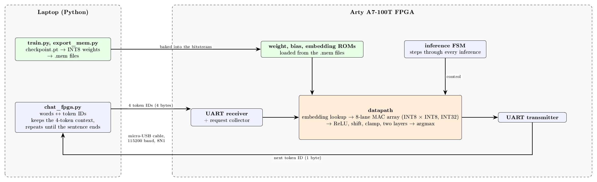
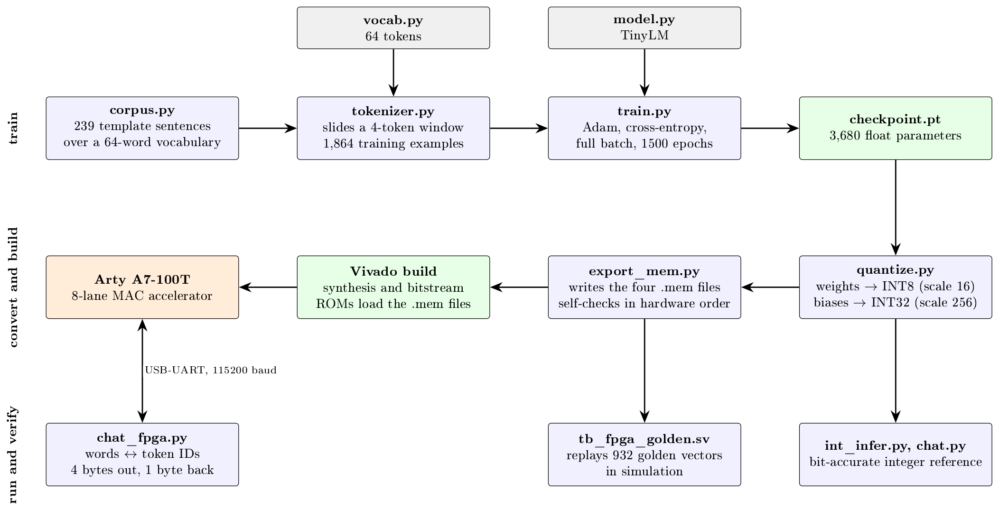
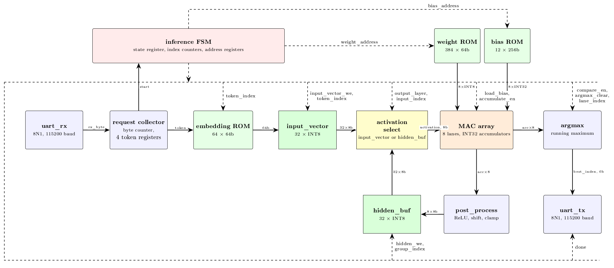
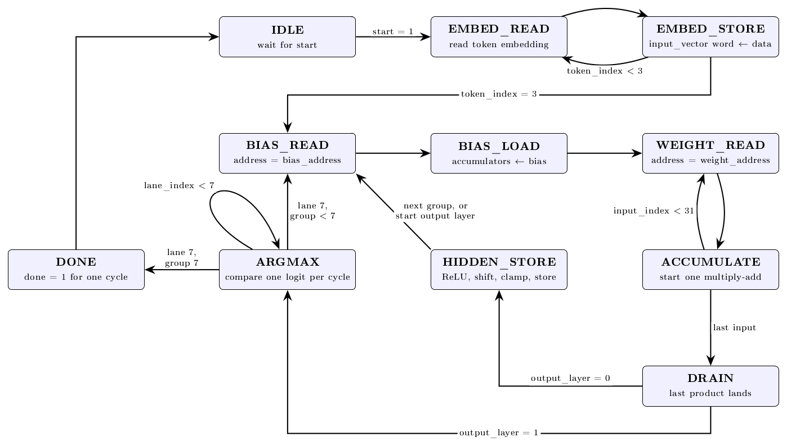
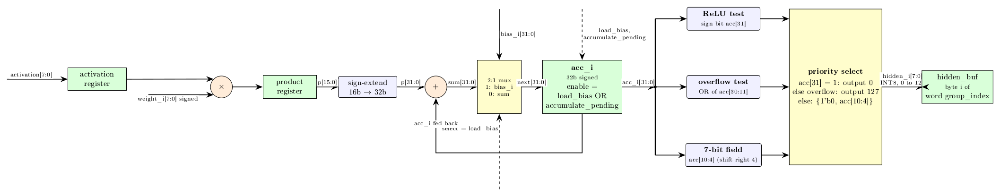

# Tiny FPGA Language Model

A miniature language model running entirely on a Digilent Arty A7-100T FPGA. A laptop sends four word tokens over USB-UART, the FPGA runs the whole neural network in hardware, and it sends back the predicted next word. Repeating that gives sentences. Built by a two-person team in a 36-hour hackathon: one half trains and quantizes the model in Python, the other half is the Verilog accelerator.



## The model

A word-level feedforward network over a 64-word vocabulary (plant-monitoring phrases such as "soil is dry"):

- 4 context tokens, each looked up in a 64 x 8 embedding table, concatenated to 32 values
- layer 1: 32 to 32 with ReLU, layer 2: 32 to 64 logits, then argmax
- 3,680 parameters; INT8 weights and activations (scale 16), INT32 accumulators and biases (scale 256)



Training is PyTorch (`langModel/train.py`). `langModel/quantize.py` converts the floats to integers, and `langModel/int_infer.py` is a bit-accurate integer reference: whatever the FPGA computes must equal it exactly. Details and measurements are in [langmodel_overview.pdf](langModel/model_docs/langmodel_overview.pdf).

## The accelerator

One reusable **8-lane multiply-accumulate array**, not a systolic array. Each step, one activation is broadcast to all eight lanes, each lane multiplies it by its own INT8 weight and adds into its own INT32 accumulator, so eight output neurons are computed at once. The same array and FSM serve both layers (4 groups of 8 outputs, then 8 groups of 8). Weights, biases and embeddings live in on-chip ROMs loaded from `.mem` files. No DDR, AXI, soft CPU or attention.



A single FSM sequences the embedding lookup, both layers, the argmax and the reply: **under a thousand clock cycles per predicted token**, a small fraction of the time one UART byte takes at 115200 baud.



Each lane registers its product before adding it, which keeps the multiplier's critical path short, and post-processing is a sign test, one OR gate and a bit selection:



More detail: [fsm_and_lanes.pdf](rtl/rtl_docs/fsm_and_lanes.pdf), [hardware_schematic.pdf](rtl/rtl_docs/hardware_schematic.pdf) (high level and low level), and [nn_math_walkthrough.pdf](rtl/rtl_docs/nn_math_walkthrough.pdf) (the same machine described as neural-network math).

## Serial protocol

115200 baud, 8N1, one request at a time. The laptop sends **4 raw bytes**, the last four token IDs (0 to 63, oldest first). The FPGA replies with **1 raw byte**, the predicted token ID. Python does the words, the 4-token context and the generation loop, which is why the hardware needs no tokenizer. The low four bits of the last prediction also show on the board's LEDs.

## How we verify it

- **Every module has a self-checking testbench** in `tb/` (MAC lane and array, ROMs, buffers, post-process, argmax, UART, request collector, and a cycle-by-cycle check of the FSM against an independently built expected trace).
- **The export checks itself.** `langModel/export_mem.py` re-reads the `.mem` files it wrote, recomputes every logit in the hardware's own order, and requires an exact match with `int_forward` on all training contexts plus thousands of random ones.
- **Whole-system golden test.** `tb_fpga_golden` sends 932 golden vectors (from the Python reference) through the real `fpga_top` as serial bytes and compares every reply.
- **On the board.** A bring-up design proves the clock and the UART bit timing (with a scope on the Pmod pins), and the real build includes an ILA and a VIO for looking inside the running FPGA.

## Repository

| Folder | Contents |
|---|---|
| `rtl/` | SystemVerilog: `ctrl/` (FSM), `core/` (MAC lane and array, post-process, activation select), `mem/` (ROMs and buffers), `uart/`, `util/` (argmax), `top/`; `rtl_docs/` has the LaTeX diagrams and PDFs |
| `tb/` | testbenches |
| `mem/` | the generated ROM files (see [mem/README.md](mem/README.md) for the format), golden vectors and test patterns |
| `langModel/` | Python: vocabulary, corpus, model, training, quantization, integer reference, export, chat programs; `model_docs/` has the PDF |
| `vivado/` | Tcl scripts for the project, simulation, build and programming |
| `constraints/` | pin constraints for the Arty A7-100T |

## Running it

Python 3 for the language-model side; Vivado (we used 2026.1) for the hardware.

```
python -m langModel.train                  # train (needs PyTorch), writes checkpoint.pt
python -m langModel.export_mem             # quantize and write mem/*.mem + golden vectors (standard library only)
python -m langModel.chat                   # chat with the integer reference model (needs PyTorch)
```

In the Vivado Tcl console (use the full path to the repo):

```
source <repo>/vivado/create_project.tcl    # build the project
source <repo>/vivado/sim_fpga_golden.tcl   # replay the golden vectors through fpga_top
```

Build and program the board, then chat with it:

```
vivado -mode batch -source <repo>/vivado/build_fpga_top.tcl
vivado -mode batch -source <repo>/vivado/program_bitstream.tcl -tclargs <repo>/vivado/build_fpga_top/fpga_top.bit
pip install pyserial
python -m langModel.chat_fpga --port COM5 --verify
```

`--verify` also checks every FPGA reply against the integer reference. There is one `vivado/sim_*.tcl` script per testbench.
